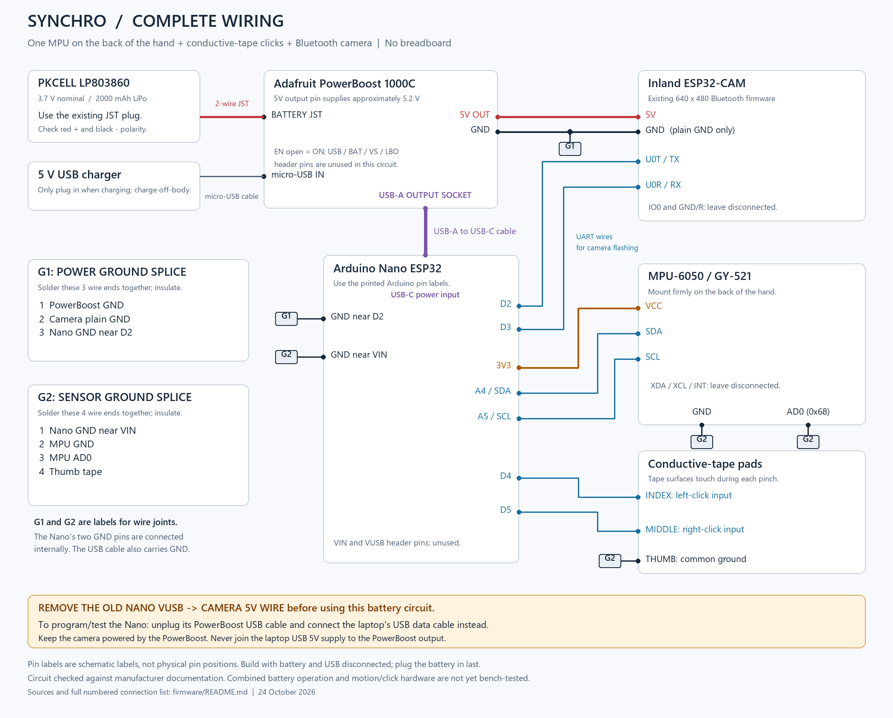

# Synchro hardware and firmware

## Current motion viewer

For the new 1 kHz MPU acquisition, double-precision laptop angle estimator,
camera-window contact indicators, and 15-second calibration, see
[MOTION.md](MOTION.md). This uses `NanoMotionAngles` on the Nano. Older
`NanoMotionTest` bring-up results and programming-bridge wiring below are
historical; the current camera runs separately over Bluetooth.

## Complete battery-powered circuit (current wiring plan)

Updated 2026-10-24 for the Nano ESP32, Inland ESP32-CAM, one MPU-6050 / GY-521
on the back of the hand, conductive-tape click contacts, Adafruit PowerBoost
1000C, and PKCELL LP803860 3.7V 2000mAh battery. No breadboard is required.
The user confirmed the PowerBoost's USB-A output socket is soldered on.



Editable drawing: `hardware/synchro-complete-wiring.svg`. Rebuild both image
formats with `tools/draw_schematic.py` (Python + Pillow). The diagram uses
pin labels, not physical board/header positions.

### Power arrangement

The PowerBoost powers the Nano through a short **USB-A-to-USB-C cable**.
It powers the camera separately through its **5V output pin**. The Nano
then supplies the MPU from **3V3**. The Nano's VIN pin is specified for
6-21V, so the PowerBoost's approximately 5.2V output is not routed to VIN.
The Nano datasheet lists 4.8-5.5V for the USB-connector input.

**Remove the earlier Nano VUSB-to-camera-5V wire before using this circuit.**
Nano VIN and the VUSB header pin are both left unused. The PowerBoost pin
labeled USB is a charging input, not its boosted output; use the pin
labeled 5V for the camera. Disconnect all power before assembling.

### Every required connection

| No. | From | To |
| --- | --- | --- |
| 1 | Battery's existing two-wire JST plug | PowerBoost battery JST socket; verify red is + and black is - |
| 2 | PowerBoost USB-A output socket | Nano USB-C socket, using a USB-A-to-USB-C cable |
| 3 | PowerBoost 5V output pin | Camera 5V pin |
| 4 | PowerBoost GND | G1 soldered ground junction |
| 5 | Camera pin labeled GND | G1 soldered ground junction |
| 6 | Nano GND near D2 | G1 soldered ground junction |
| 7 | Nano GND near VIN | G2 soldered ground junction |
| 8 | MPU GND | G2 soldered ground junction |
| 9 | MPU AD0 | G2 soldered ground junction |
| 10 | Thumb conductive-tape pad | G2 soldered ground junction |
| 11 | Nano 3V3 | MPU VCC |
| 12 | Nano A4 | MPU SDA |
| 13 | Nano A5 | MPU SCL |
| 14 | Nano D4 | Index-finger conductive-tape pad (left-click input) |
| 15 | Nano D5 | Middle-finger conductive-tape pad (right-click input) |
| 16 | Nano D2 | Camera U0T / TX |
| 17 | Nano D3 | Camera U0R / RX |

G1 and G2 are names for **insulated wire splices**, not extra board pins:

- G1 joins three wire ends: PowerBoost GND, camera plain GND, Nano GND near D2.
- G2 joins four wire ends: Nano GND near VIN, MPU GND, MPU AD0, thumb pad.

Both Nano GND pins are internally connected. The USB power cable also
carries ground; the explicit G1 wires retain a common ground when the
Nano's cable is moved to the laptop for programming. Camera 5V comes
directly from the booster, so camera current need not pass through the
Nano's header ground connection. Use short power/ground wires with secure
joints. Insulate both splices fully and provide strain relief.

The index and middle pads are separate inputs, not permanent connections
to the ground splice. Thumb-to-index contact closes left click; thumb-to-middle
closes right click. D4/D5 use internal pull-ups and 25 ms debounce in the
prepared diagnostic sketch. The pads need physical conductive-surface
contact and an insulating backing.

### Charging, programming, and unused pins

- **Charging connection (18, when needed):** 5V USB charger to the PowerBoost's
  micro-USB input; keep the battery in its JST socket. Charge off the body.
- **Nano programming or USB diagnostics:** remove the PowerBoost-to-Nano USB
  cable at the Nano, then plug in the laptop's USB data cable. The camera can
  remain powered by the PowerBoost, with G1/G2 and signal wiring retained.
  Do not connect laptop USB 5V to the booster's output; do not restore the old
  VUSB-to-camera wire while the booster is attached.
- **Camera programming:** restore `NanoCamBridge` onto the Nano first, use
  the laptop USB connection above, and temporarily connect camera IO0 to an
  actual GND for flashing. Remove that temporary jumper to run the camera.
  `NanoMotionTest` does not forward camera serial traffic.
- **Leave unused:** Nano VIN/VUSB headers; MPU XDA/XCL/INT; camera GND/R and
  normal-operation IO0; PowerBoost USB/BAT/VS/LBO header pins. The battery
  is already connected through JST. Camera GND/R may be reset on this board
  variant and has not been verified as ground.
- **PowerBoost EN:** leave unconnected for always-on operation. An optional
  two-terminal switch between EN and GND turns output OFF when closed and
  ON when open. This switch is not required and is not included in the main
  connection list. Do not connect EN to VS through a three-terminal switch.

This is a documented design, **not a completed combined battery hardware
test**. The PowerBoost is nominally a 1A-class supply; simultaneous startup
and radio/camera loads must be tested for stable operation. Do not infer
that a successful single-board test verifies both boards under load.
The motion/click diagnostic is now uploaded to the Nano and its initial
MPU communication test passed over laptop USB; it does not yet generate
laptop mouse events. Movement/tilt response has also passed. The copper
contacts subsequently passed separate left-held, right-held, and released
state checks over laptop USB; calibration and mouse-control firmware remain
pending.

Camera power-path check on 2026-10-24: after the user reported connecting
camera 5V/GND to the PowerBoost and powering the Nano via the PowerBoost's
USB-A socket, a direct Bluetooth probe decoded all 120 VGA frames in
9.86 seconds (12.17 fps). Camera status showed zero capture failures;
uptime increased from 23,230 to 51,208 ms and the frame count reached 120,
with no reset observed. This supports basic operation of that reported
power wiring under this short camera load; it does not measure voltage,
verify unused header joints, or test MPU data/clicks. Images were about
7.4 kB in a largely uniform scene, so this rate is not directly comparable
to the earlier 11-12 kB/frame scene. Results and first/last images are in
`.local/powerboost-camera-test-20261024-200022/`, including `report.json`
and `status-after.json`. The live viewer was reopened after the probe.

Power references: [Nano ESP32 datasheet, power specifications](https://docs.arduino.cc/resources/datasheets/ABX00083-datasheet.pdf),
[PowerBoost 1000C pinouts](https://learn.adafruit.com/adafruit-powerboost-1000c-load-share-usb-charge-boost/pinouts),
[PowerBoost USB assembly](https://learn.adafruit.com/adafruit-powerboost-1000c-load-share-usb-charge-boost/assembly),
[PKCELL 803860 battery specification](https://cdn-shop.adafruit.com/datasheets/LiIon2000mAh37V.pdf).

The sections below preserve the earlier USB-powered bring-up. Their
VUSB-to-camera wiring is an alternative historical setup and must not be
combined with the complete battery-powered circuit above.

## Earlier USB-powered camera wiring

The laptop connects by USB-C to an Arduino Nano ESP32. `NanoCamBridge`
forwards the laptop's USB serial port to a separate ESP32-CAM.

| Nano ESP32 | ESP32-CAM |
| --- | --- |
| D2 (bridge RX) | U0T / GPIO1 (TX) |
| D3 (bridge TX) | U0R / GPIO3 (RX) |
| GND | GND |
| VBUS / VUSB | 5V, only when using the Nano's USB power |

Both serial signals use 3.3V logic. Do not connect 5V to 3V3 or a signal
pin. When using a separate regulated 5V supply for the camera, remove
the VBUS wire and retain the shared ground. USB power capacity has to
be verified with the camera running.

Connect **IO0 to GND on the ESP32-CAM**, then press the camera's RST
button to enter its ROM bootloader. Remove that jumper before resetting
to run the camera program: GPIO0 is also the camera clock signal.
Disconnect power before changing the wiring.

## Programs

- `NanoCamBridge`: compile for `arduino:esp32:nano_nora`, normal TinyUSB
  mode. The yellow LED stays on. The UART follows the USB host baud
  rate (9600–921600); tests start at 115200. Use `--before no_reset`
  with esptool v4 so DTR/RTS do not interfere with native USB CDC.
- `SynchroCam`: compile for `esp32:esp32:esp32cam:FlashMode=dio,FlashFreq=40`, using Espressif
  Arduino core 2.0.17. This uses the AI-Thinker pin map and supports the
  OV3660 sensor observed on this Inland board. Resolution starts at
  320×240 JPEG with quality 16 to reduce Wi-Fi transfer size. The white
  flash LED stays off.

`SynchroCam/secrets.h` holds the local access-point name and password.
It is excluded from Git; `secrets.example.h` shows the required format.

The camera creates its own password-protected Wi-Fi network. After
joining it, open **http://192.168.4.1/** and press **Start live view**.
This network does not provide internet. There is no eduroam dependency.

Firmware v2's browser viewer fetches one JPEG at a time, decodes it, then
requests the next. It cancels stalled requests after 2.5 seconds and retries;
Stop or hiding the page cancels the viewer. The page displays measured frame
rate and request/decode time, which is not full sensor-to-screen latency.
The legacy MJPEG endpoint remains available for other clients, without the
v1 artificial 100 ms delay. HTTP socket timeouts are two seconds.
`/status` also reports AP client count, last capture/send duration, JPEG size,
and failed HTTP photo sends to help distinguish camera and network delays.

Endpoints:

- `/`: viewer page on port 80.
- `/status`: JSON diagnostics on port 80.
- `/capture`: one JPEG on port 80.
- `/stream`: MJPEG on port 81.

Use only on the intended local network. The web endpoints have no
separate login; devices knowing the Wi-Fi password can view the camera.

## Upload and testing

Build outputs go in `.build/`. The camera upload uses esptool v4 with
`--chip esp32 --port COM5 --baud 230400 --before no_reset --after no_reset_stub`.
Write these compiled files using their actual build paths:

| Address | File |
| --- | --- |
| 0x1000 | SynchroCam.ino.bootloader.bin |
| 0x8000 | SynchroCam.ino.partitions.bin |
| 0xe000 | Espressif core tools/partitions/boot_app0.bin |
| 0x10000 | SynchroCam.ino.bin |

Use flash mode DIO, flash frequency 40MHz, and flash size 4MB. These
parameters target the ESP32-CAM, not the Nano's ESP32-S3.

After uploading, disconnect USB, remove only the camera IO0–GND jumper,
and reconnect USB. Keep the serial/power connections in place.

`tools/Test-Camera.ps1` waits for the camera to run, queries status,
tests three HTTP endpoints internally over TCP, and receives three real
JPEGs through the Nano. It writes diagnostic results and photos to
`.local/camera-test/`, excluded from Git. This verifies the camera and
local HTTP handlers; a phone or other Wi-Fi client must separately
verify wireless viewing and the live stream.

The serial commands at 115200 baud are `STATUS`, `HTTPTEST`, and
`CAPTURE`, each followed by a newline. `CAPTURE` returns a length-prefixed
binary JPEG between `JPEG_BEGIN` and `JPEG_END` markers.

The original full-flash backup, if successfully completed, is stored
under `backups/`. Keep it private: original flash can include network
credentials. A complete backup is exactly 4,194,304 bytes.

References: [Espressif CameraWebServer](https://github.com/espressif/arduino-esp32/tree/2.0.17/libraries/ESP32/examples/Camera/CameraWebServer),
[boot-mode selection](https://docs.espressif.com/projects/esptool/en/latest/esp32/advanced-topics/boot-mode-selection.html),
[Nano ESP32 datasheet](https://docs-content.arduino.cc/resources/datasheets/ABX00083-datasheet.pdf).

## Bluetooth laptop viewer

`SynchroCamBluetooth` is a separate camera firmware, built with the same
`esp32:esp32:esp32cam:FlashMode=dio,FlashFreq=40` configuration. It runs Bluetooth
Classic SPP with Wi-Fi off, and advertises `Synchro-Cam-BT`. Its pairing PIN
is in its ignored `secrets.h`; create it using `secrets.example.h` for a new
setup. Bluetooth firmware v2 uses 640×480 JPEG, with the same JPEG quality
setting (16) as v1. The viewer accepts both the original 320×240 frames and
640×480 frames, and displays their actual dimensions. The Nano needs no
firmware change. The working 320×240 firmware and viewer are preserved in
`.local/camera-bluetooth-qvga-baseline`.

Upload with `tools/Upload-Camera.ps1 -Sketch SynchroCamBluetooth` after
putting the camera into programming mode. Then power off, remove IO0–GND,
and reconnect USB. Run `tools/Get-Bluetooth-Camera.ps1` to verify the
firmware and save its real Bluetooth address/channel to
`.local/bluetooth-camera.json`.

`tools/pair_bluetooth_camera.py` uses the Windows Bluetooth pairing API
with the configured PIN and only the camera address obtained from USB.
Alternatively, pair `Synchro-Cam-BT` through Windows Settings with that PIN.
`tools/bluetooth_viewer.py` opens a native RFCOMM socket to the paired camera.
It does not use Wi-Fi, a virtual COM port, or USB for image data.
Python's standard library and Pillow are sufficient; the bundled runtime
already contains Pillow and Tk. Launch the app with
`tools/Start-Bluetooth-Camera.ps1`, or run the Python viewer directly.

The Windows viewer now defaults to 180-degree rotation. The Rotate 180°
checkbox changes the displayed image immediately, and Save photo uses the
same selected orientation. `--rotate 0` starts with the original orientation.
This is a viewer-only change; camera firmware and raw probe JPEGs are unchanged.
The updated Windows GUI was verified receiving the real 640x480 Bluetooth feed,
and all seven existing camera protocol tests passed.

The supported desktop viewer is the Windows app in `tools/bluetooth_viewer.py`.
Use `--preview` for interface development on another operating system.

## Earlier USB-powered motion bring-up (reference only)

The current design uses one MPU-6050 / GY-521 on the back of the hand for
motion and three conductive contacts for clicking. The second, finger-mounted
MPU is omitted. Disconnect USB before wiring; keep the PowerBoost and battery
disconnected during this USB-powered bring-up.

Use the Nano's printed pin labels (D4/D5 are Arduino labels, not raw GPIO
numbers). Keep the boards on a nonconductive surface and keep wires short.

| Nano ESP32 connection | Destination |
| --- | --- |
| VUSB | ESP32-CAM 5V |
| First GND pin | ESP32-CAM pin labeled GND |
| D2 | ESP32-CAM U0T |
| D3 | ESP32-CAM U0R |
| 3V3 | MPU VCC |
| A4 | MPU SDA |
| A5 | MPU SCL |
| Second GND pin | Shared ground-wire junction described below |
| D4 | Index-finger conductive pad (left click) |
| D5 | Middle-finger conductive pad (right click) |

The two Nano GND pins share electrical ground. Keep the camera's IO0-GND
jumper removed. Leave the camera's GND/R pin unused: some camera variants
connect this pin to reset, and this board's GND/R function has not been
measured. Do not assume it is an extra ground. The older photo-only pin
mapping must not override the actual GND/R marking reported by the user.

The shared ground-wire junction electrically joins FOUR wires: one from
the Nano's second GND, one to MPU GND, one to MPU AD0, and one to the thumb
contact. Make this with an insulated soldered splice or a suitable splitter
connector. One-to-one jumper wires alone cannot form the branch.

```text
Nano GND #1 ---------------------- camera GND

Nano GND #2 ----- ground junction ----- MPU GND
                                  |--- MPU AD0 (address 0x68)
                                  +--- thumb conductive pad
```

Leave MPU XDA, XCL, and INT unconnected. The contact layout assumes thumb
to index for left click and thumb to middle for right click. Put the pads
on an insulating glove/backing with their conductive surfaces exposed to
touch each other. Each wire must contact its pad's conductive surface;
do not rely on the tape's adhesive being conductive. These are physical
tape-to-tape switches, not capacitive skin-touch inputs. Do not permanently
join D4/D5 to the ground junction; only a pinch closes each contact.

D4 and D5 use INPUT_PULLUP. A pinch connects the corresponding input to
the grounded thumb pad, producing LOW. The test sketch debounces both
press and release for 25 ms. No external pull-up resistors are required
for this initial short-wire test.

`NanoMotionTest/NanoMotionTest.ino` uses the core Wire library and needs
no additional MPU library. Compile for `arduino:esp32:nano_nora`. Upload
to the **Nano**, not to the ESP32-CAM. This replaces the Nano UART bridge
while motion testing; `NanoCamBridge` remains available to restore it.
The camera continues running its own Bluetooth firmware while powered,
but camera USB diagnostic/upload helpers require the bridge restored.

At 115200 baud over USB, motion-test firmware v2 reports the MPU at 0x68,
checks identity/configuration, and emits CSV at a target 50 Hz. Columns are
`ms,address,imu_ready,ax_g,ay_g,az_g,gx_dps,gy_dps,gz_dps,temp_c,left_down,right_down`.
Acceleration is in g (including gravity), angular rate in degrees/second,
and chip temperature in Celsius. Ranges are +/-4 g and +/-500 degrees/second;
readings are uncalibrated. `left_down`/`right_down` are 1 while a debounced
contact is closed, otherwise 0. Contact reporting continues if the MPU
is missing, with `imu_ready=0` and `nan` motion/temperature values.

Comments beginning with `#` report readiness and read failures. Detection
retries every two seconds; do not change physical wiring while powered.
The Nano now runs this diagnostic. Expect acceleration-vector
magnitude near 1 g while stationary, gyro values near zero apart from bias,
and readings that change when moved. Verify each pinch separately and
verify release returns its contact state to zero. This is a diagnostic
sketch; cursor movement, actual mouse-button events, and gesture training
are subsequent steps.

`tools/Test-Motion.ps1 -Port COM5 -Seconds 12 -Phase initial` records the
diagnostic stream over the Nano's real USB serial port. It saves CSV,
diagnostics, and a JSON report under `.local/motion-<phase>-<timestamp>/`.
The report counts valid/missing sensor samples, malformed rows, sample
timing, timestamp resets, per-axis ranges, acceleration magnitude, and
observed contact press/release transitions. Supported labels are `initial`,
`still`, `moving`, and `clicks`; the label does not itself prove that the
user performed the corresponding action. A connected-but-idle input does
not verify a conductive-tape switch until real press/release transitions
have been observed.

Verified initial MPU communication on 2026-10-24: the Nano was identified
as USB VID 2341/PID 0070, serial 206EF131643C, COM5 / DFU path 4-2.1.
DFU upload of `NanoMotionTest` completed successfully (306,512 bytes).
After an explicit DFU detach/restart and opening CDC with DTR asserted
before RTS, the reader collected 392 valid samples in about 8 seconds,
exactly 50 Hz in the device timestamps. There were no missing samples,
malformed rows, read failures, timeouts, or backwards timestamps.
Acceleration magnitude averaged 0.9999 g (0.9921-1.0065 g); both click
inputs stayed released. The uncalibrated gyro had a roughly -4.4 degrees/s
X offset during this mostly steady recording; this is not a calibration
measurement confirmed by the user. Results are in
`.local/motion-initial-20261024-200652/`. The earlier no-data attempt is
preserved separately for diagnostics.

Movement follow-up: `.local/motion-moving-20261024-200740/` contains 752
valid samples over 15 seconds with only small orientation changes. To
resolve that ambiguity, the user then repositioned and held the MPU;
`.local/motion-still-20261024-200832/` contains 402 valid samples over
8 seconds. Mean X acceleration changed from +0.6758 g in the initial
capture to -0.0054 g; mean Z changed from -0.7293 g to -0.9484 g. The
gyro also responded, with Z readings ranging from -33.466 to +13.786
degrees/s in the repositioned recording. The three successful captures
total 1,546 valid samples, each at 50 Hz, with no read failures, missing
samples, malformed rows, timeouts, or backwards device timestamps.
This verifies communication and motion response, not calibrated cursor
tracking. Calibration should be performed after final mounting; the
repositioned acceleration magnitude averaged 0.9581 g and gyro offsets
remain uncompensated. At that stage, the conductive-tape pads were not
wired, so those continuously released inputs were not a click test result.

Copper-contact follow-up on 2026-10-24: with the Nano connected directly to
the laptop on COM5, four 4-second captures verified separated pads (0,0),
thumb touching index (1,0), thumb touching middle (0,1), and all pads
separated again (0,0). The user confirmed each held-contact position and
the final separation. All 798 samples matched the expected contact state,
with 50 Hz sampling and no missing MPU samples, malformed rows, or read
timeouts. Evidence is in `.local/contact-test-20261024-232216.json` and its
four referenced CSV/report folders. These static checks verify each
contact activates independently and releases; rapid repetitive pinches,
actual laptop mouse events, and combined battery operation remain untested.

The two Nano-camera UART wires were removed for this MPU test, as confirmed
by the user when connecting the Nano directly to the laptop. The camera
can continue independently from the PowerBoost. Those UART wires are only
needed again if restoring the Nano bridge for camera diagnostics/flashing.

References: [Nano ESP32 pinout](https://docs.arduino.cc/resources/pinouts/ABX00083-full-pinout.pdf),
[MPU-6050 specification](https://product.tdk.com/system/files/dam/doc/product/sensor/mortion-inertial/imu/data_sheet/mpu-6000-datasheet1.pdf),
[MPU-6050 register map](https://invensense.tdk.com/wp-content/uploads/2015/02/MPU-6000-Register-Map1.pdf),
[GPIO pull-ups](https://docs.espressif.com/projects/arduino-esp32/en/latest/api/gpio.html),
[camera GND/R board variants](https://github.com/prusa3d/Prusa-Firmware-ESP32-Cam/blob/master/doc/AI_Thinker-ESP32-cam/README.md).
